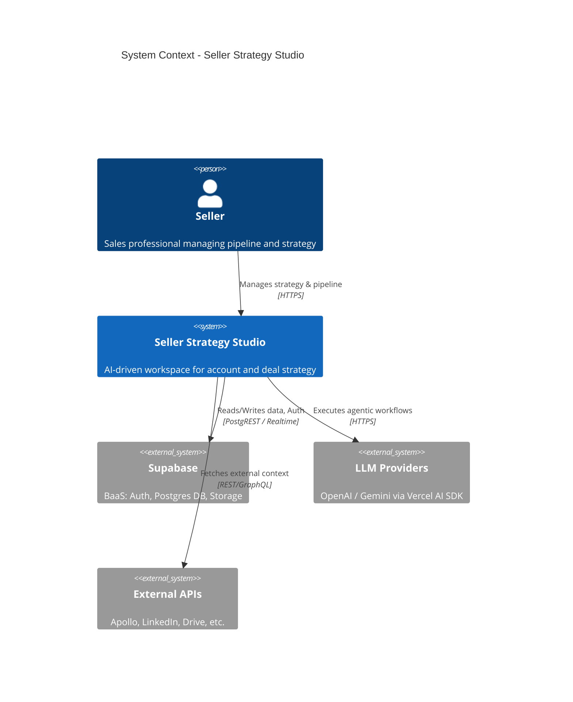

# Architecture Spine: Seller Strategy Studio

## 1. Paradigm & Stack

The system follows a **SPA + BaaS + AI Agent Toolkit** paradigm. It leverages a managed backend for heavy lifting (auth, database, real-time) while keeping the frontend highly interactive and AI-driven.

- **Frontend**: TanStack Start (React 19), `@tanstack/react-router`.
- **Backend/BaaS**: Supabase (Postgres, Auth, Storage).
- **AI/Agents**: Vercel AI SDK (`@ai-sdk/openai`, Gemini fallback), `@lovable.dev/mcp-js`.
- **Styling**: Tailwind CSS v4, shadcn/ui.
- **State Management**: `@tanstack/react-query` (Server State), React Context/Hooks (Local State).

## 2. Invariants (Architecture Decisions)

### AD-1: SPA + BaaS + AI Agent Toolkit
- **Rule**: The application is a Single Page Application (via TanStack Start) backed by Supabase for data/auth, and Vercel AI SDK for agentic features.
- **Binds**: TanStack Start, Supabase, Vercel AI SDK.
- **Prevents**: Custom backend services for standard CRUD, traditional SSR MVC patterns.

### AD-2: Supabase Postgres as Source of Truth
- **Rule**: All persistent state lives in Supabase. Multi-tenancy is strictly enforced via `org_id` and Row Level Security (RLS) policies.
- **Binds**: Postgres schema, RLS for authorization.
- **Prevents**: Fragmented data stores, trusting client-side data for authorization.

### AD-3: React Query for Server State
- **Rule**: All data fetching, caching, and synchronization with Supabase must use `@tanstack/react-query`.
- **Binds**: React Query hooks for data access.
- **Prevents**: Using global state managers (Redux, Zustand) to store server data.

### AD-4: Server-side AI Tool Execution
- **Rule**: AI logic, prompt construction, and tool execution (e.g., `agent.server.ts`) must run securely on the server environment.
- **Binds**: Vercel AI SDK server functions, secure tool definitions (`src/lib/agent/tools/`).
- **Prevents**: Client-side API key exposure, client-side execution of sensitive data mutations.

### AD-5: Utility-First Styling
- **Rule**: UI components must be styled using Tailwind CSS and built upon shadcn/ui (Radix) primitives.
- **Binds**: Tailwind CSS, `src/components/ui/`.
- **Prevents**: Custom `.css` files, CSS-in-JS libraries (Styled Components, Emotion).

## 3. Structural Boundaries

## 4. Deferred & Open Questions

- **Background Jobs**: `inngest` is confirmed as the engine for asynchronous background processing (`src/lib/inngest/functions.server.ts`).
- **Multi-tenancy RLS**: Row Level Security (RLS) in Supabase is the designated mechanism to isolate data by `org_id`.
- **Analytics & Observability**: PostHog is integrated (`posthog-panel.tsx`) for product analytics.
- **Deployment Environment**: Standard Node.js environment supporting TanStack Start SSR/API routes.