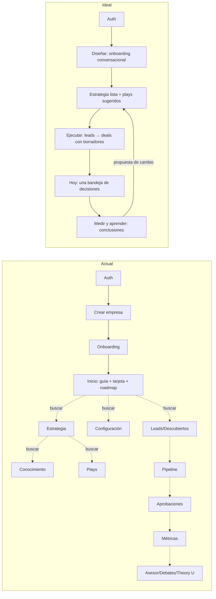

# Auditoría UX/UI, flujos e integraciones de NOKKO — 14-11-2026

Auditoría **en solo lectura**: no se ha cambiado código de producto, base de datos ni configuración. El único archivo creado es este. La evidencia viene del código de `main` en el sandbox (lectura estática de rutas, componentes, herramientas del agente e integraciones). Leyenda: `R/` = `src/routes/_authenticated/`, `C/` = `src/components/`.

---

## 1. Resumen ejecutivo

**Veredicto:** NOKKO tiene un núcleo sólido: datos multiempresa con RLS, un único registro de herramientas del agente compartido por app, Telegram y MCP, escrituras siempre confirmadas y un sistema de diseño centralizado. La sensación de «Frankenstein» no viene de pantallas rotas. Viene de la **arquitectura de información**: 24 destinos de menú, 13 de ellos metidos en un único desplegable «Estrategia» que mezcla diseñar, ejecutar, medir y aprender, varias puertas para el mismo trabajo y ningún hilo que lleve al founder de un paso al siguiente.

**Los 5 problemas que más dañan al founder:**
1. **Tres puertas para «definir mi estrategia»:** Onboarding (fuera del menú), Configuración (en Ajustes) y Estrategia (8 pestañas), además de la guía de Inicio y la tarjeta «Configura tu estrategia» (UX-001).
2. **El grupo «Estrategia» del menú es un cajón de sastre:** reúne 13 destinos (Métricas, Plays, Aprobaciones, Descubiertos, Memoria, Theory U…) que nada tienen que ver con la estrategia (UX-002).
3. **Cuatro bandejas de «cosas por hacer»:** Sugerencias, Aprobaciones, Tareas y acciones pendientes del agente, más el mazo y los siguientes pasos de Inicio (UX-003).
4. **Inicio sigue sobrecargado:** guía, mazo, briefing, roadmap, cuatro KPI, payback, siguientes pasos y paneles. Hallazgo del 31-oct sin resolver (UX-004).
5. **Las Conexiones no dicen la verdad del modelo de cuenta:** casi todo usa claves compartidas del despliegue, las tarjetas de proveedores llevan a Cuentas en lugar de a un paso de conexión, el presupuesto no cubre todo el gasto y algunas herramientas «de lectura» gastan dinero sin confirmación (UX-030 a UX-036).

**Propuesta en una frase:** reorganizar NOKKO en una historia de cuatro tiempos (**Hoy · Diseñar · Ejecutar · Medir y aprender**) más **Ajustes**, con el agente como capa transversal en tres niveles de autonomía (Guiado, Copiloto y Autopilot), reutilizando lo que ya existe en lugar de construir un segundo producto.

---

## 2. Lectura asumida y limitaciones

- **Lectura asumida 1:** el «miembro» del encargo corresponde a cualquier rol sin poderes de liderazgo (AE, SDR, marketing…). El catálogo real de roles no tiene `member` (`src/lib/roles.ts:1-12`).
- **Lectura asumida 2:** «Plays GTM, catálogo de 28» = biblioteca de plays más plays a medida en `/plays`. No he contado el catálogo uno a uno: **NO VERIFICADO** que sean exactamente 28.
- **Lectura asumida 3:** «Diagnóstico» se refiere a dos cosas que hoy conviven: el diagnóstico GTM del onboarding (arquetipo y etapa) y el diagnóstico AARRR, que es una pestaña de Estrategia.
- **Limitaciones:**
  - No hay recorridos con sesión real por rol ni medición en navegador de contraste, foco o 390 px en este informe. Todo lo de accesibilidad y móvil es estático salvo lo citado de verificaciones previas (`docs/verificacion-20261114.md`).
  - No he consultado analítica de uso: no hay datos de uso, porcentajes ni tiempos (**sin dato**).
  - No he auditado políticas SQL una a una. Ocultar un botón no equivale a seguridad, y la autorización efectiva por tabla queda **NO VERIFICADA** aquí.
  - Importes, tarifas y contratos con proveedores: **sin dato**.
  - Conectividad real de producción (secretos configurados, bot de Telegram, dominio de Resend, saldo de proveedores): **NO VERIFICADO**.

---

## 3. Fase 0 — Inventario real

### 3.1 Rutas

**42 declaraciones de ruta:** 30 pantallas autenticadas, 3 públicas o de consentimiento (`/`, `/auth`, `/.lovable/oauth/consent`) y 9 de sistema (`/mcp`, `/.well-known/oauth-protected-resource`, `/sitemap.xml`, `/api/public/{leads,accounts,inngest,jobs/proactive,telegram/webhook,apollo/phone-webhook}`).

| Ruta | Nombre | Propósito | Quién | Entrada | Entidades (L/E) |
|---|---|---|---|---|---|
| `/home` | Inicio | Resumen y siguientes pasos | Todos (alcance líder/vendedor) | Menú, ⌘K, logo, barra móvil | L: deals, meetings, approvals, people, accounts, sugerencias (`R/home.tsx:38-79`) |
| `/inbox` | Sugerencias | Decidir propuestas y pendientes | Todos | Menú, barra móvil | sugerencias, agent_pending_actions |
| `/accounts` | Cuentas | Listar, crear, importar empresas | Todos; Reparto solo líder | Menú | accounts y relaciones (`R/accounts.index.tsx:60-130`) |
| `/accounts/$id` | Ficha de cuenta | Ficha con pestañas | Todos | Enlaces, ⌘K | accounts, plans, stakeholders, meetings, calls, deals |
| `/accounts/assignment` | Reparto | Reglas y capacidad | Líder | Botón en Cuentas | rules, org_members.max_accounts |
| `/leads` | Leads | Tablero/lista | Todos; borrar Owner | Menú, barra móvil | leads |
| `/leads/entrada` | Entrada de leads | Fuentes, claves, CSV | Owner/líder/marketing | Leads, Pipeline, Conexiones, ⌘K | lead_sources, import_batches |
| `/deals` | Pipeline | Oportunidades y forecast | Todos; etapas líder | Menú, barra móvil | deals, mutual_action_items, approvals |
| `/people` | Personas | Contactos y campañas | Todos | Menú | people, campaigns |
| `/strategy` | Estrategia GTM | 8 pestañas de definición | Todos (edición por rol) | Menú | segments, icp, positioning, pillars… (`R/strategy.tsx:14-23`) |
| `/metrics` | Métricas | 9 secciones | Todos; finanzas líder | Menú | deals, quotas, history (`R/metrics.tsx:66-74`) |
| `/cycle` | Ciclo GTM | Artefactos por fase | Todos | Menú | gtm_artifacts |
| `/plays` | Plays GTM | Biblioteca, a medida, equipos | Todos | Menú | play_states, custom_plays |
| `/debates` | Debates | Deliberación multiagente | Todos; convocar líder | Menú | debates, tasks |
| `/theory-u` | Theory U | Aprendizaje y clínica | Todos | Menú | 5 secciones |
| `/advisor` | Asesor GTM | Recomendaciones de dirección | Solo líder (`nav.ts:37`) | Menú (líder) | gtm_advisories, gtm_experiments |
| `/abm` | ABM y partners | Cuentas objetivo y partners | Todos; decidir líder/deal_desk | Menú | partners, deal_registrations |
| `/products` | Productos | Catálogo y precios | Edita owner/líder/deal_desk | Menú | products |
| `/hub` | Conocimiento | Documentos, reglas, voz, Drive | Todos | Menú | knowledge_docs |
| `/memory` | Memoria | Lo aprendido por empresa/persona/cuenta | Todos | Menú | memories |
| `/discoveries` | Descubiertos | Empresas/personas descubiertas | Todos; búsqueda líder | Menú, ⌘K | discoveries |
| `/approvals` | Aprobaciones | Decisiones humanas | Decide owner/líder/deal_desk | Menú | approvals |
| `/company` | Empresa | Identidad de la organización | Edita Owner | Menú | organizations |
| `/team` | Equipo | Miembros, roles, Telegram | Gestiona Owner | Menú | org_members, org_invites |
| `/integrations` | Conexiones | Stripe, PostHog, Gmail, presupuesto | Todos; acciones Owner | Menú | varias |
| `/setup` | Configuración | IA, entrevista o asistente | Todos | Menú | estado de configuración |
| `/connect` | Conectar asistentes | Instrucciones MCP | Todos | Menú | — |
| `/onboarding` | Onboarding | Lectura de fuentes y aprobación | Líder completo; resto invitado | Empresa, guía Inicio; **no está en el menú** | onboarding_sessions |
| `/replies` | Respuestas | Respuestas de Gmail clasificadas | Dueño del buzón | **Solo desde la tarjeta Gmail** | inbox_replies, inbox_reply_derived |

### 3.2 Navegación actual

Dos niveles (`src/lib/nav.ts:12-58`): 6 accesos diarios y 2 desplegables, con **24 destinos en total**.

| Grupo | Destinos | N |
|---|---|---|
| Diario | Inicio, Sugerencias, Cuentas, Leads, Pipeline, Personas | 6 |
| Estrategia | Estrategia GTM, Métricas, Ciclo GTM, Plays GTM, Debates, Theory U, Asesor GTM, ABM y partners, Productos, Conocimiento, Memoria, Descubiertos, Aprobaciones | 13 |
| Ajustes | Empresa, Equipo, Conexiones, Configuración, Conectar asistentes | 5 |

Otras superficies: ⌘K (mismos destinos más búsqueda de registros), ⌘J (agente), ⌘B (plegar menú) y barra móvil (Inicio, Sugerencias, Leads, Pipeline, Agente). Fuera del menú: `/accounts/$id`, `/accounts/assignment`, `/leads/entrada`, `/onboarding` y `/replies`.

**Huérfanas:** ninguna pantalla depende solo de la URL. **Casi escondidas:** `/replies` (un único enlace) y `/onboarding` (sin menú ni ⌘K). **Muertas:** sin evidencia suficiente para declarar ninguna; haría falta telemetría.

**Asimetría en ⌘K:** al buscar una cuenta o un deal se abre el registro; al buscar un lead o una persona solo se abre la lista general (`C/command-palette.tsx:55-60`).

### 3.3 Componentes de UI

181 archivos en `src/components` (46 primitivas `ui`). Variantes por familia:

| Familia | Estado |
|---|---|
| KPI / Panel | Una definición compartida, `Kpi` con 4 tamaños (`C/page.tsx:116-183`). Consolidado |
| Vacíos | `Empty` compartido (50 usos) **y** párrafos sueltos. También se usa para «sin permiso» y «Analizando…» (`R/advisor.tsx:103-109,183`) |
| Carga/error | Al menos 3 patrones: `ScreenState`, texto local («Cargando respuestas…») y div vacío (`R/accounts.$id.tsx:59`) |
| Tablas | 34 `<table>` escritas a mano en 30 archivos frente a 2 usos de `<Table>` |
| Diálogos | 26 `<Dialog>` en 19 archivos; formularios construidos por pantalla |
| Paneles laterales | 4 `<Sheet>` directos |
| Selects | `NativeSelect` único (consolidado) más `ui/select` en la ficha de cuenta |

### 3.4 Agente

**122 herramientas: 60 de lectura y 62 de escritura** (`src/lib/agent/tools.ts:30-56`). Las escrituras crean `agent_pending_actions` y se confirman en la app, en Telegram con botones o en Sugerencias desde MCP (`agent.server.ts:202-242`, `mcp/tools/agent-tools.ts:147-187`, `telegram/webhook.ts:76-105`).

- **Canales:** panel en la app (⌘J), Telegram y MCP.
- **Primitivas:** *starters* de texto, Markdown (listas, tablas, enlaces) y tarjeta de confirmación con Confirmar, Descartar y estados (`C/agent.tsx:210-265`). No hay respuestas rápidas estructuradas ni tarjeta de enlace a un registro.
- **Voz:** no existe (sin STT ni TTS). «Voz de empresa» es estilo de redacción (`src/lib/ai-core.ts:52-70`).

### 3.5 Puntos de conexión

`/integrations` (Stripe, PostHog, Gmail, presupuesto y tarjetas informativas), `/connect` (MCP), `/team` (Telegram con código), `/leads/entrada` (webhooks de entrada) y `/hub` (Drive). `/setup` y `/onboarding` leen fuentes, pero **no** conectan proveedores.

---

## 4. Fase 1 — Recorridos de extremo a extremo

Los clics se cuentan como pasos de navegación mínimos según el código, sin medirlos en sesión (**aproximado**). Continuidad: 0 = buscar a mano; 3 = el producto te lleva solo.

| # | Recorrido | Pasos reales | Dónde se pierde | Continuidad media |
|---|---|---|---|---|
| 1 | Primer día | `/auth` → crear empresa (`C/org-create.tsx:77`) → `/onboarding` (fuentes → lectura en segundo plano → hallazgos → aprobación por bloques → diagnóstico → roadmap) → Inicio | Al volver a Inicio aparecen la guía, la tarjeta «Configura tu estrategia» y el roadmap a la vez; Configuración ofrece otros tres métodos para lo mismo | **2** (el onboarding encadena bien por dentro; la salida se dispersa) |
| 2 | Diseñar la estrategia | Estrategia (Segmentos → ICP → Modelos → Posicionamiento → Mensajes) → Conocimiento (reglas Nunca/Siempre, voz) → Plays | Las reglas y la voz viven en otra sección (Conocimiento) y los Plays en otra (Plays GTM); no hay un «siguiente» entre ellas. Los objetivos/cuotas están en Métricas | **1** |
| 3 | Conseguir y calificar leads | Leads → Entrada (claves/CSV) o Descubiertos → score → asignación (Reparto, solo cuentas) → primer contacto (borrador vía agente o ficha) | Descubiertos está en «Estrategia». El reparto existe para cuentas y no para leads. El borrador de primer contacto no tiene botón propio en la lista | **1** |
| 4 | Llevar un deal | Pipeline → panel del deal (Sheet largo, etapa con guardado inmediato y resto con «Guardar deal») → reuniones/llamadas (ficha de cuenta) → aprobación de etapa ganada → Aprobaciones | Reuniones y llamadas viven en la ficha de cuenta, no en el deal. El cierre ganado crea una aprobación que se decide en otra pantalla. El motivo de pérdida no tiene un flujo propio verificado (**NO VERIFICADO**) | **2** |
| 5 | Operar cada semana | Informe semanal (email/agente) → Sugerencias → Aprobaciones → Tareas → Estrategia | Cuatro bandejas. Las tareas no tienen pantalla propia de primer nivel (se ven en Sugerencias/Inicio) | **1** |
| 6 | Aprender y corregir | Métricas → Asesor (solo líder) / revisión estratégica / Debates / Theory U / Memoria → cambio en Estrategia | No hay bucle cerrado: las conclusiones del Asesor y de los Debates generan experimentos o tareas, pero no vuelven como propuesta de cambio en la pantalla de Estrategia afectada | **0–1** |

---

## 5. Fase 2 — Arquitectura de información y solapes

### 5.1 Matriz de solapes y acción recomendada

| Conceptos que compiten | Problema que resuelven | Acción |
|---|---|---|
| Onboarding / Configuración (`/setup`) / guía Inicio / tarjeta «Configura tu estrategia» | Dejar lista la estrategia inicial | Onboarding: **MANTENER** como único recorrido inicial. Configuración: **FUSIONAR en Onboarding** (sus métodos IA, entrevista y asistente pasan a ser modos del mismo flujo). Guía y tarjeta: **FUSIONAR** en un único «siguiente paso» en Hoy |
| Diagnóstico GTM (onboarding) / Diagnóstico AARRR (pestaña de Estrategia) | Saber dónde estoy | **MANTENER** ambos con nombres distintos: «Arquetipo» (línea principal) y «Embudo AARRR» |
| Estrategia / Conocimiento / Memoria | Qué decidimos / qué documentos y reglas usa NOKKO / qué ha aprendido | Estrategia **MANTENER**. Reglas y voz de Conocimiento: **DEGRADAR a pestaña de Estrategia** («Reglas y voz»). Documentos y Drive: siguen en Conocimiento. Memoria: **DEGRADAR a sección de Ajustes → Lo que NOKKO recuerda** |
| Asesor / revisión estratégica / Sugerencias | Recibir recomendaciones | Revisión estratégica: **FUSIONAR en Asesor**. Las propuestas del Asesor entran en la bandeja única de Hoy |
| Sugerencias / Aprobaciones / Tareas / pendientes del agente | Qué tengo que decidir o hacer | **FUSIONAR en una bandeja «Hoy»** con filtros (Decidir, Aprobar, Hacer, Confirmar agente). Las entidades siguen separadas en la base de datos; solo cambia la superficie |
| Plays / playbooks / biblioteca | Jugadas ejecutables / guías por etapa / adaptación de guías | Plays **MANTENER** en Ejecutar. Playbooks **RENOMBRAR a «Guías de venta»** dentro de Conocimiento para que no choque con «biblioteca de plays» |
| Ciclo GTM / Debates / Theory U / Clínica de casos | Metodologías colaborativas | **OCULTAR tras modo avanzado** en «Medir y aprender → Talleres»; Clínica sigue dentro de Theory U |
| Informe semanal / Métricas / KPIs | Saber cómo vamos | Métricas **MANTENER**; el informe semanal se enlaza desde Hoy; los KPI son un componente, no un producto |
| Leads / Personas / Cuentas | Prospecto en cualificación / contacto / empresa | **MANTENER** los tres con el glosario único (5.2) |
| Conexiones / Configuración / Conectar asistentes / Equipo `#mcp` | Conectar cosas | **FUSIONAR en Ajustes → Conexiones** (una pantalla, véase 7.4) |
| Descubiertos | Empresas nuevas según ICP | **MOVER a Ejecutar** junto a Leads |
| Aprobaciones | Decisión humana | **FUSIONAR en Hoy** (filtro «Aprobar») |

### 5.2 Vocabulario y glosario propuesto

> **Decisión de Fede (15-nov-2026):** se mantienen «Equipo de plays», «Playbook», «Valor anual (ACV)» y «Modelo de venta». Menú en 5 secciones aceptado. Residuo: nombre accesible «Filtrar por motion» fijado por `-plays.test.tsx` (intocable).

| Término único | Variantes encontradas | Definición |
|---|---|---|
| Cuenta | empresas, clientes | Empresa a la que vendes o vendiste |
| Persona | contactos | Alguien de una cuenta |
| Lead | entrada, prospectos | Persona en cualificación, de Nuevo a Oportunidad |
| Deal | pipeline, oportunidades | Lead convertido en negociación con importe |
| Sugerencia | bandeja, tareas | Propuesta de NOKKO para decidir |
| Tarea | (se mezcla con Sugerencias en `nav.ts`) | Compromiso de alguien del equipo |
| Aprobación | — | Cambio importante que valida un rol autorizado |
| Play | jugadas, señales, automatizaciones | Disparador más acción preparada por NOKKO |
| Guía de venta | playbook | Documento por etapa |
| Conexiones | integraciones | Servicios externos |
| Valor anual (ACV) | Importe, Importe (ACV), Valor estimado, Valor (`field-help-data.ts:137`) | Un solo rótulo |
| Modelo de venta | Motion | Un solo rótulo con tooltip |
| Equipo | «equipo de plays» | Personas de la empresa; los «equipos de plays» pasan a llamarse «grupos de plays» |

### 5.3 Carga cognitiva

- **Primer nivel:** 8 entradas estructurales y 24 destinos.
- **Jerga:** MEDDPICC (20 apariciones) y ABM (20) **sin definición global** en `field-help`. ACV, CAC y payback sí la tienen.
- **Densidad:** Estrategia tiene 8 pestañas y Métricas 9 secciones.
- **Formulario del deal:** largo, con guardado mixto (`R/deals.tsx:497,591-631`).

### 5.4 Roles

- Casi todos ven el mismo menú; solo el Asesor es `leadersOnly`.
- **Al miembro le sobran** Ciclo, Debates (con botones deshabilitados «Solo Owner o Sales Leader»), Reparto y Aprobaciones (no puede decidir).
- **Faltan avisos claros de permiso:** Asesor y revisión estratégica muestran `Empty` en lugar de un estado específico de «sin permiso» que diga quién puede hacerlo.
- **Memoria:** si la carga falla, se muestra como memoria vacía (`R/memory.tsx:61-75`).

---

## 6. Fase 3 — UI y sistema de diseño

- **Tokens:** centralizados en `src/styles.css:29-108`. Fondo blanco roto `--paper: #f6f6f4` ✔. Conmutador claro/oscuro funcional y sin parpadeo (`C/theme-toggle.tsx`) ✔.
- **Colores hardcodeados:** 4 `bg-black/80` (overlays de primitivas), 9 coincidencias `#hex` (barra del navegador y selectores de gráfico) y 0 `text-white` o `bg-[…]`. Deuda baja.
- **Patrones:**
  - `Page` unifica las cabeceras (30 archivos).
  - `ScreenState` se usa solo en 19 archivos.
  - Los estados de carga, vacío y sin permiso no son uniformes (3.3).
  - Las cabeceras de Cuentas y Pipeline siguen con demasiadas acciones (hallazgo del 31-oct vigente).
- **Móvil 390 px:**
  - Las tablas de Cuentas y Leads ocultan columnas o hacen scroll.
  - El panel del deal es largo.
  - Métricas es densa.
  - Corregido el 14-11: desbordamiento de la barra superior en onboarding.
- **Accesibilidad:**
  - MEDDPICC usa botones `size-6` en escritorio, sin `aria-pressed` ni grupo (`R/deals.tsx:595-612`).
  - Auth no ofrece recuperar contraseña ni mostrarla.
  - Hay un `<main>` en el shell.
  - Contraste real: **NO VERIFICADO**.
- **Microcopy:**
  - Los errores pasan por `errorText()` ✔.
  - La tarjeta de Gmail dice «Solo lee remitente y fecha», pero la clasificación (activada el 14-11) lee el cuerpo (`C/reply-inbox/mailbox-card.tsx:47`). Es **texto falso: P0 de confianza** (UX-036).

**Deuda priorizada:** (1) estados vacío, carga, error y sin permiso uniformes; (2) tablas con un componente `DataTable` responsive; (3) formulario del deal por pestañas con guardado único; (4) MEDDPICC accesible; (5) Auth completo; (6) cabeceras con una sola acción principal y el resto en «Más».

**Sistema objetivo** (los tokens ya existen; faltan 14 componentes base): `Page`, `PageHeader` (1 acción principal + «Más»), `Section`, `DataTable` (responsive, orden, selección masiva, vistas guardadas), `RecordSheet`, `FormField` (con ayuda), `EntityCombobox`, `StatusChip`, `Kpi`, `ScreenState` (carga/error/vacío/**sin permiso**), `ConfirmDialog`, `NextStepCard`, `ConnectionCard`, `AgentProposalCard`.

---

## 7. Fase 3B — Conexiones e integraciones

### 7.1 Inventario y estado

| Integración | Para qué (founder) | Modelo de cuenta hoy y credencial | Estado | Coste y presupuesto | Agente/MCP |
|---|---|---|---|---|---|
| Lovable Cloud (datos y auth) | Base de todo | Compartida (plataforma) | Operativa | sin dato | — |
| OpenRouter (Gemini, Anthropic y OpenAI) | IA general, onboarding, agente, clasificación de correo | Compartida, `OPENROUTER_API_KEY` en env (`src/lib/gemini.ts:29-40`) | Operativa (clave renovada y probada el 14-11) | sin dato; no pasa entera por el presupuesto | Implícita |
| Gemini directo | Respaldo IA | Compartida, `GEMINI_API_KEY` | Operativa en código, sin verificar | sin dato | — |
| Anthropic directo | Evaluación GTM Lab | Compartida, `ANTHROPIC_API_KEY` | Parcial (solo evaluación) | sin dato | — |
| Lovable AI Gateway | Respaldo condicional | Compartida, `LOVABLE_API_KEY` | Operativa condicionada a `AI_LOVABLE_FALLBACK` (la memoria del proyecto dice «nunca respaldo Lovable AI»: **revisar coherencia**) | sin dato | — |
| Jev | Calificación de leads | Gateway compartido | Operativa en código | sin dato | Sí |
| Apollo | Buscar, enriquecer, revelar emails/teléfonos | Compartida, `APOLLO_API_KEY`, y secreto de webhook en query | Operativa; revelado con timeout de 15 s | Revelado con ledger; búsquedas «lectura» sin confirmación | Lectura y escritura confirmada |
| Clay | Buscar empresas y stakeholders | Compartida | Operativa en código | Solo por orquestador cuando entra por él | Lectura |
| Parallel | Informes profundos, listas ICP | Compartida | Operativa (polling Inngest) | `enrich_accounts_table` es lectura y gasta | Lectura y escritura |
| Perplexity | Búsqueda web y señales | Compartida | Operativa (probada con R-1) | `searchBoth` fuera del presupuesto | Lectura |
| Firecrawl | Leer webs | Compartida (API directa) | Operativa | Parcialmente orquestada | Lectura |
| Apify (LinkedIn/G2) | Señales y battlecards | Compartida | Operativa; tope por ejecución `maxTotalChargeUsd` | Sin tope mensual | Lectura y escritura |
| Google Drive | Importar y guardar documentos | **Compartida del builder** (`GOOGLE_DRIVE_API_KEY`) | Operativa en código | sin dato | Lectura y escritura |
| PostHog | Uso de producto por cuenta | **Por empresa**, AES-GCM (`posthog_connections.api_key_enc`) | Operativa | sin dato | Lectura |
| Stripe | Ingresos y MRR | **Por empresa**, Vault (`stripe_key_for`) | Operativa | sin dato | Lectura |
| Resend | Email 8:00 e informe | Compartida, `avisos@nokko.ai` | Parcial (la UI dice que falta verificar el dominio; la prueba anterior fue aceptada) | sin dato | — |
| Telegram | Agente y avisos en el móvil | Un bot compartido, vínculo por persona | Parcial: **falta el token del bot** | sin dato | Canal completo |
| Inngest | Segundo plano | Compartida | Operativa en código, despliegue sin verificar | sin dato | — |
| Logo.dev | Logos | Token público `VITE_` | Operativa | sin dato | — |
| Gmail (Respuestas) | Detectar y clasificar respuestas | **Conexión compartida del builder**, `mailbox_links` por empresa/persona; solo superadmin | Parcial, puerta legal | Recibos propios, fuera del presupuesto | No (aislado por diseño) |
| MCP | Claude, ChatGPT y Codex | OAuth de Lovable Cloud como el usuario | Operativa | Herramientas pueden gastar | Escrituras a pendientes |
| Entrada pública de leads/cuentas | Formularios, Zapier, Make, CRM | **Por conexión/empresa**, clave `gtm_…` hasheada | Operativa; contador diario no atómico | — | — |
| HubSpot, Pipedrive, Attio, Salesforce, Calendar, Gong, Fireflies | — | Ninguna | Solo documentadas (tarjetas manuales) | — | — |

**Experiencia de conexión:**
- Las tarjetas de Apollo, Clay, Firecrawl, Parallel y Perplexity **llevan a Cuentas**, no a un paso de conexión (`R/integrations.tsx:58-95`).
- Los estados del «Plan de herramientas del equipo» son etiquetas manuales, no comprobaciones.
- Solo Stripe, PostHog y Gmail tienen un formulario real.

### 7.2 Criterios (1 = bajo, 3 = alto)

| Integración | Valor recorrido | Fricción si BYO | Coste variable | Términos (revisar con asesoría) | Riesgo legal/aislamiento | Datos del cliente |
|---|---|---|---|---|---|---|
| IA (OpenRouter) | 3 | 3 | 3 | Revisar reventa | 1 | 2 |
| Apollo | 3 | 2 | 3 | **Revisar con asesoría** (servir datos a terceros con una cuenta) | 2 | 1 |
| Clay | 2 | 2 | 3 | Revisar con asesoría | 2 | 1 |
| Parallel / Perplexity / Firecrawl | 2 | 2 | 2 | Revisar | 1 | 1 |
| Apify (LinkedIn) | 1 | 2 | 2 | **Revisar con asesoría** (extracción de LinkedIn) | **3** | 1 |
| Drive | 2 | 1 (OAuth) | 1 | — | **3** (un Drive del builder para todas las empresas) | **3** |
| Gmail | 2 | 1 (OAuth) | 1 | — | **3** (conexión compartida) | **3** |
| Stripe / PostHog | 2 | 2 | 1 | — | 1 | **3** |
| Telegram / MCP / Webhooks | 2 | 1 | 1 | — | 1 | 1 |
| Resend / Inngest / Logo.dev | 2 | — | 1 | — | 1 | 1 |

### 7.3 Clasificación propuesta (hoy → propuesto)

| Integración | Hoy | Propuesto | Prioridad del cambio |
|---|---|---|---|
| Lovable Cloud, Inngest, Resend, Logo.dev | Compartida | **CORE** | — |
| IA (OpenRouter y respaldos) | Compartida | **CORE** (con tope por empresa) | Media: añadir presupuesto |
| Perplexity, Firecrawl, Parallel | Compartida | **CORE con cuenta propia opcional** | Media |
| Apollo | Compartida | **CORE con cuenta propia opcional** (respaldo en NOKKO al agotarse, según la decisión vigente) | **Alta** (términos y coste) |
| Clay | Compartida | **CUENTA PROPIA DE LA EMPRESA** | Alta (coste por crédito) |
| Stripe, PostHog | Por empresa | **CUENTA PROPIA DE LA EMPRESA** (ya lo es) | — |
| Google Drive | Compartida del builder | **CUENTA PROPIA DE CADA PERSONA (OAuth)** | **Alta** (aislamiento) |
| Gmail | Compartida del builder | **CUENTA PROPIA DE CADA PERSONA (OAuth)** | **Alta** antes de abrir a otros buzones |
| Telegram, MCP, entrada de leads/cuentas | Canal | **CANAL/ENTRADA DE NOKKO** | Baja (contador atómico) |
| Apify LinkedIn | Compartida | **CANDIDATA A PAUSAR** hasta revisión legal (mantener G2) | **Alta** (riesgo) |
| CRM nativos, Calendar, Gong, Fireflies | Tarjetas | **ELIMINAR las tarjetas** hasta que exista conexión (o marcarlas «Próximamente») | Baja |
| Anthropic directo (evaluación) | Compartida | Interno, no visible | — |

**Resumen:** 5 CORE (Cloud, Inngest, Resend, Logo.dev, IA) · 4 CORE con cuenta propia opcional (Perplexity, Firecrawl, Parallel, Apollo) · 3 cuenta propia de empresa (Clay, Stripe, PostHog) · 2 cuenta propia por persona (Drive, Gmail) · 3 canales (Telegram, MCP, entrada pública) · 1 a pausar (Apify LinkedIn) más tarjetas de CRM sin conexión a retirar. **Deben cambiar primero:** Drive y Gmail (aislamiento), Apify LinkedIn (riesgo) y Apollo/Clay (términos y coste).

### 7.4 Pantalla única de Conexiones (Ajustes → Conexiones)

Una tarjeta por integración con: estado real («Incluida en NOKKO», «Tu cuenta», «Sin conectar», «Error: …»), quién la conectó y cuándo, uso del mes (desde `integration_usage` y los recibos), qué deja de funcionar si se desconecta y un botón «Probar conexión».

Patrones por tipo:
- **Pegar clave:** formulario seguro con cifrado, como Stripe o PostHog.
- **OAuth:** botón «Conectar con Google».
- **Enlace o código:** Telegram `/vincular`.
- **Webhook:** URL con clave revocable, como Entrada.

El agente **puede iniciar y guiar** cualquiera de ellas devolviendo un enlace profundo a la tarjeta; **nunca** recibe secretos en el chat.

### 7.5 Orden de activación

- **Día 1:** ninguna. Todo lo CORE funciona solo. Opcional: Telegram.
- **Justo a tiempo:** Apollo propio al revelar contactos más allá del cupo; Drive al importar documentos; Gmail al tener leads en Contactado; Stripe y PostHog al abrir Métricas → Ingresos o Uso.
- **Avanzadas:** Clay, MCP, webhooks de CRM.

### 7.6 Riesgos operativos en segundo plano

1. **El presupuesto no es un límite duro:** lectura y registro van separados, y al 100 % solo se pausa lo automático (`orchestrator/runner.ts:49-66`, `planner.ts:156-197`).
2. **Gasto fuera del presupuesto:** `web-search.ts:35-41`, clasificación de correo y Apify.
3. **Herramientas «de lectura» que gastan sin confirmación:** Apollo y Clay (búsquedas), Apify y `enrich_accounts_table`.
4. **Contador del intake no atómico** (`intake.server.ts:14-18`).
5. **Secreto del webhook de Apollo en la query string** (`apollo/phone-webhook.ts:12-14`).
6. **El cron proactivo concentra trabajos**, incluidas detección y clasificación de correo.
7. **Polling de Parallel** de hasta 120 iteraciones.
8. **Sincronización de Stripe y PostHog** en lotes de 5 empresas.

---

## 8. Fase 4 — Modo Autopilot conversacional

### 8.1 Paridad pantalla ↔ agente (huecos por área)

| Área | Paridad | Huecos |
|---|---|---|
| Pipeline, reuniones, tareas, sugerencias/aprobaciones | Alta | Borrado explícito; motivo de pérdida estructurado (**NO VERIFICADO**) |
| Leads, cuentas, personas | Buena | Importación y revisión de cuarentena |
| Estrategia (ICP, posicionamiento, mensajes) | Parcial | Presupuestos y modelos de venta completos |
| Conocimiento / reglas / voz | Parcial | Editar reglas Nunca/Siempre y voz |
| Memoria | **Hueco** | Corregir, fijar y olvidar |
| Plays | Parcial | Editor completo de plays a medida |
| ABM / partners | **Hueco** | Partners, registros de deals |
| Debates / Theory U / Clínica | **Hueco** | Convocar y facilitar |
| Asesor | **Hueco** | Lanzar una sesión |
| Productos | **Hueco** | Catálogo y precios (sensible: deal_desk) |
| Equipo | **Hueco** | Invitaciones y roles (debe seguir solo en la UI) |
| Conexiones | **Hueco** | Iniciar una conexión con enlace profundo |
| Onboarding | Parcial | Conducir el flujo entero de fuentes y aprobación |

### 8.2 Diseño del Autopilot

**Niveles de autonomía** (por persona, visibles en el panel del agente y reversibles en un clic):

| Nivel | Qué hace | Qué nunca hace |
|---|---|---|
| **Guiado** | Responde y explica; cada acción es una tarjeta que el founder confirma de una en una | — |
| **Copiloto** (por defecto) | Propone el siguiente paso al terminar cada acción y prepara el borrador | — |
| **Autopilot** | Encadena un flujo completo (p. ej. «de cero a estrategia») y agrupa las escrituras en **puntos de aprobación** por bloque | — |
| **Ninguno** | — | Enviar mensajes, publicar, borrar sin confirmar, pegar o pedir secretos, saltarse roles, gastar por encima del tope |

**Flujo «de cero a estrategia ejecutándose»** (reutiliza `onboarding_read`, `applySetupItems` y las herramientas existentes):
1. «¿Cuál es tu web? ¿Tienes un deck o documento?» → lectura en segundo plano (ya existe).
2. Muestra los hallazgos en lista con Confirmar, Editar o Descartar (primitiva de lista).
3. Preguntas de diagnóstico: ticket, modelo de venta, etapa. Resultado: arquetipo de la línea principal.
4. Borradores de ICP, posicionamiento y mensajes. **Punto de aprobación 1.**
5. Reglas de empresa y voz. **Punto de aprobación 2.**
6. Plays recomendados según el arquetipo. **Punto de aprobación 3** (activar no gasta; el gasto se rige por el tope).
7. Primera búsqueda de cuentas por ICP con coste visible. **Punto de aprobación 4.**
8. «Continuar donde lo dejé» guardado en `onboarding_sessions`.

**Guardarraíles:**
- Escrituras siempre en `agent_pending_actions`.
- Tope de gasto por empresa **aplicado a toda llamada facturable**, incluidas las de «lectura» (corrige 7.6).
- Comprobación de rol al confirmar.
- Deshacer donde exista (`undoSetupItems`).
- Registro «qué hizo NOKKO y por qué» en el centro de actividad.

**Primitivas neutras al canal:**

| Primitiva | App | Telegram | WhatsApp (futuro) |
|---|---|---|---|
| Texto | Markdown | Texto | Texto |
| Respuestas rápidas | Chips | Botones inline | Botones de respuesta (máx. 3) |
| Lista seleccionable | Lista con checks | Mensajes numerados | Lista interactiva |
| Confirmación | Tarjeta | Botones Confirmar/Cancelar (ya existe) | Botones |
| Enlace profundo | Tarjeta con ruta | URL | URL |

**Voz:**
- **v1 sin pantallas nuevas:** dictado (STT) en el campo del agente y respuesta leída (TTS) opcional, ambos con el AI Gateway en el servidor.
- **Latencia:** la de una transcripción más la de un turno (**sin dato medido**).
- **Privacidad:** el audio no se guarda.
- **Nunca por voz:** secretos o claves, borrados, cambios de roles y aprobaciones de gasto (requieren tocar).

**Entrada única:** ⌘K busca y navega, ⌘J conversa, y ambos aceptan `/comandos` («/nuevo lead», «/preparar reunión»). Cada pantalla tiene sugerencias contextuales del agente y «Continuar donde lo dejé» en Hoy.

**Estado compartido:** el agente usa las mismas queries y claves de caché (`useLivePipeline` ya invalida los deals). Toda acción del agente aparece en el registro de la entidad con la marca «NOKKO» (ya existe la procedencia por campo).

### 8.3 Riesgos y mitigaciones

| Riesgo | Mitigación concreta |
|---|---|
| Gasto descontrolado | Tope por empresa transaccional (reserva antes de llamar, como en los plays a medida) para **todo** proveedor |
| Acciones irreversibles | Solo pendientes confirmados; borrados solo desde la UI y por el Owner |
| Alucinación de datos | Procedencia y fecha por campo; exigir fuente en las señales (filtro de competidor ya aplicado) |
| Fuga entre empresas | `org_id` explícito en cada herramienta (`expectScoped`); Drive y Gmail con OAuth por persona |
| Confianza excesiva | El modo Autopilot muestra un resumen de cada bloque antes de aprobar; nunca envía |

---

## 9. Fase 5 — Arquitectura unificada

### 9.1 Navegación objetivo (5 secciones más el agente transversal)

| Sección | Propósito | Contiene |
|---|---|---|
| **Hoy** | Qué hago ahora | Siguiente mejor paso, bandeja única (Sugerencias + Aprobaciones + Tareas + pendientes del agente), Respuestas, informe semanal |
| **Diseñar** | Mi estrategia | Onboarding (único), Estrategia (segmentos, ICP, modelos, posicionamiento, mensajes, reglas y voz), Productos, Líneas de negocio |
| **Ejecutar** | Vender | Cuentas, Leads (+ Entrada, Descubiertos), Personas, Pipeline, Plays, ABM y partners |
| **Medir y aprender** | Cómo vamos y qué cambiamos | Métricas, Asesor, Talleres (avanzado: Ciclo, Debates, Theory U) |
| **Ajustes** | Configurar | Empresa, Equipo, Conexiones (única, incluye MCP), Conocimiento (documentos y Drive), Memoria |

| Pantalla actual | Nueva ubicación |
|---|---|
| Inicio, Sugerencias, Aprobaciones | Hoy |
| Onboarding, Configuración | Diseñar → Onboarding |
| Estrategia GTM, Productos | Diseñar |
| Conocimiento (reglas/voz) | Diseñar → Estrategia → Reglas y voz |
| Conocimiento (documentos/Drive) | Ajustes → Conocimiento |
| Cuentas, Leads, Personas, Pipeline, Plays, ABM, Descubiertos | Ejecutar |
| Métricas, Asesor | Medir y aprender |
| Ciclo, Debates, Theory U | Medir y aprender → Talleres (modo avanzado) |
| Memoria | Ajustes |
| Empresa, Equipo, Conexiones, Conectar asistentes | Ajustes (Conectar asistentes dentro de Conexiones) |
| Respuestas | Hoy |

### 9.2 Recorrido ideal (6 pasos, siempre con «siguiente mejor paso»)

1. **Crear la empresa** y entrar.
2. **Diseñar conversando:** onboarding y aprobaciones por bloque.
3. **Activar plays** y lanzar la primera búsqueda.
4. **Trabajar leads y deals** con borradores.
5. **Decidir cada día en Hoy.**
6. **Revisar en Medir y aprender**, con propuestas de cambio que vuelven a Diseñar.

### 9.3 Hoy

Muestra solo lo que ya se calcula:
- Titular calculado (`src/lib/headlines.ts`).
- Un «siguiente mejor paso» (fusión de la guía, la tarjeta de estrategia y NextSteps).
- Bandeja única con contadores.
- Tres KPI (pipeline abierto, forecast ponderado, cobertura).
- Reuniones de hoy y respuestas nuevas.

El payback, el roadmap y el briefing pasan a enlaces.

### 9.4 Modo simple y avanzado

Por defecto ocultos (sin eliminarlos): Talleres (Ciclo, Debates, Theory U), Reparto, las secciones RevOps de Métricas más allá del embudo y del trimestre, y MEDDPICC detallado.

### 9.5 Reglas de microcopy

- Usar el glosario de 5.2.
- Un verbo por botón.
- La jerga siempre con tooltip (añadir MEDDPICC y ABM).
- Los estados sin permiso dicen quién puede hacerlo.
- Nunca afirmar lo que el sistema no hace (véase UX-036).

---

## 10. Fase 6 — Plan por olas

| Ola | Pieza | Qué cambia / archivos aprox. | Dependencias | Riesgo | Esfuerzo | Hecho cuando | Decisión |
|---|---|---|---|---|---|---|---|
| 0 | 0.1 Texto veraz en la tarjeta de Gmail | `C/reply-inbox/mailbox-card.tsx` | — | Bajo | S | La tarjeta menciona la lectura del cuerpo y los 30 días | — |
| 0 | 0.2 ⌘K abre el lead o la persona concretos | `C/command-palette.tsx` | — | Bajo | S | Prueba abre `?lead=` | — |
| 0 | 0.3 `/replies` y `/onboarding` en ⌘K | `src/lib/nav.ts` | — | Bajo | S | Prueba de nav | — |
| 0 | 0.4 Estado «sin permiso» propio | `C/page.tsx`, Asesor, revisión | — | Bajo | S | `ScreenState kind=forbidden` con quién | — |
| 0 | 0.5 Memoria muestra el error | `R/memory.tsx` | — | Bajo | S | Prueba de error | — |
| 0 | 0.6 Tooltips de MEDDPICC y ABM | `field-help-data.ts` | — | Bajo | S | Prueba de catálogo | — |
| 0 | 0.7 Retirar o marcar tarjetas de CRM sin conexión | `R/integrations.tsx` | — | Bajo | S | — | Sí (retirar o «Próximamente») |
| 1 | 1.1 Navegación en 5 secciones | `src/lib/nav.ts` (+ test), shell | 0.3 | Medio | M | `nav.test.ts` actualizado **con permiso de Fede** (prueba protegida) | **Sí** |
| 1 | 1.2 Glosario único | Copys de pantallas, `field-help-data.ts` | — | Bajo | M | Búsqueda sin variantes | Sí (glosario) |
| 2 | 2.1 Bandeja única en Hoy | `R/home.tsx`, `R/inbox.tsx`, `R/approvals.tsx` | 1.1 | Medio | L | Un listado con 4 filtros, sin cambios de tablas | Sí |
| 2 | 2.2 Configuración dentro de Onboarding | `R/setup.tsx`, `R/onboarding.tsx` | 1.1 | Medio | M | `/setup` redirige | — |
| 2 | 2.3 Reglas y voz como pestaña de Estrategia | `C/hub/*`, `R/strategy.tsx` | 1.1 | Bajo | M | — | — |
| 2 | 2.4 Revisión estratégica dentro del Asesor; propuestas que vuelven a Estrategia | `C/strategy-review.tsx`, `R/advisor.tsx` | 2.1 | Medio | M | Una propuesta aceptada abre el campo afectado | — |
| 2 | 2.5 Hoy simplificado (9.3) | `R/home.tsx`, `headlines.ts` | 2.1 | Medio | M | Pruebas de headlines intactas | — |
| 3 | 3.1 `DataTable` responsive + selección masiva | `C/ui/*`, Cuentas, Leads, Personas | — | Medio | L | Sin scroll lateral a 390 px | — |
| 3 | 3.2 Panel del deal por pestañas, guardado único | `R/deals.tsx` | — | Medio | M | — | — |
| 3 | 3.3 MEDDPICC accesible y Auth completo | `R/deals.tsx`, `src/routes/auth.tsx` | — | Bajo | M | Teclado y lector de pantalla | — |
| 3B | 3B.1 Pantalla única de Conexiones con estado real y «Probar» | `R/integrations.tsx`, `/connect` | 1.1 | Medio | L | Cada tarjeta prueba su conexión | — |
| 3B | 3B.2 Tope de gasto transaccional para todo proveedor | `orchestrator/*`, `web-search.ts`, herramientas | — | **Alto** (toca el gasto) | L | Pruebas: el tope bloquea la lectura facturable | **Sí** (importes) |
| 3B | 3B.3 Drive y Gmail con OAuth por persona | Conectores App User, `google-drive.ts`, `reply-inbox` | Revisión legal | **Alto** (**permisos y migración**) | L | Ningún Drive ni buzón compartido | **Sí** |
| 3B | 3B.4 Pausar Apify LinkedIn | `agent/tools/linkedin.ts` | — | Medio | S | — | **Sí** |
| 3B | 3B.5 Apollo y Clay con cuenta propia | Tabla de credenciales cifradas (**migración**) | 3B.1 | Alto | L | — | **Sí** |
| 3B | 3B.6 Contador atómico del intake y secreto de Apollo en cabecera | `intake.server.ts`, webhook | — | Medio | S | Prueba de concurrencia | — |
| 4 | 4.1 Niveles de autonomía | `C/agent.tsx`, `agent.server.ts`, preferencia por persona (**migración**) | 2.x | Medio | M | — | Sí (nivel por defecto) |
| 4 | 4.2 Primitivas neutras (chips, lista, enlace) | Núcleo del agente, Telegram | — | Medio | M | Mismas primitivas en app y Telegram | — |
| 4 | 4.3 Flujo conversacional de onboarding | Herramientas de onboarding | 2.2, 4.2 | Medio | L | De la web a la estrategia aprobada por chat | — |
| 4 | 4.4 Paridad: Memoria, reglas, conexiones (enlace), Asesor | `agent/tools/*` + manifiesto MCP | — | Medio | M | — | — |
| 5 | 5.1 Dictado y lectura en voz | Agente y AI Gateway | 4.x | Medio | M | — | Sí (coste) |
| 5 | 5.2 Telegram operativo, WhatsApp después | Bot | **Token del bot** | Bajo | S | — | Sí |

**En paralelo:** la Ola 0 entera; 3.x con 3B.x; 4.2 con 3.x. **Chocan:** 1.1 con 2.x (hay que hacerlas en orden); 2.1 con 2.5 (misma pantalla). **Migraciones o permisos:** 3B.2, 3B.3, 3B.5 y 4.1. **Pruebas protegidas afectadas:** la navegación (1.1) requiere permiso explícito para cambiar `nav.test.ts`.

---

## 11. Registro de hallazgos

| ID | Sev. | Ubicación | Evidencia | Impacto | Recomendación | Ola |
|---|---|---|---|---|---|---|
| UX-001 | P0 | `/onboarding`, `/setup`, `/strategy`, Inicio | Tres puertas para la estrategia inicial | El founder no sabe dónde empezar | Onboarding único | 2.2 |
| UX-002 | P1 | `src/lib/nav.ts:30-43` | 13 destinos en «Estrategia» | Busca a mano | 5 secciones | 1.1 |
| UX-003 | P1 | `/inbox`, `/approvals`, tareas, pendientes | Cuatro bandejas | Se dejan decisiones sin ver | Bandeja única | 2.1 |
| UX-004 | P1 | `R/home.tsx:89-194` | Inicio con 9+ bloques | No ve qué hacer | Hoy simplificado | 2.5 |
| UX-005 | P1 | Asesor, Debates, Memoria | Sin bucle de vuelta a Estrategia | No aprende | Propuestas que vuelven | 2.4 |
| UX-006 | P2 | `C/command-palette.tsx:55-60` | Lead/persona abre la lista | Clic extra | Abrir el registro | 0.2 |
| UX-007 | P2 | `/replies`, `/onboarding` | Fuera del menú y de ⌘K | Difícil de encontrar | Añadir a ⌘K/Hoy | 0.3 |
| UX-008 | P1 | `R/advisor.tsx:103-109`, `strategy-review.tsx:45-50` | `Empty` como «sin permiso» | No sabe quién puede hacerlo | Estado forbidden | 0.4 |
| UX-009 | P1 | `R/memory.tsx:61-75` | El error se ve como vacío | Cree que no hay memoria | Mostrar el error | 0.5 |
| UX-010 | P2 | `field-help-data.ts` | MEDDPICC y ABM sin definición | Jerga | Tooltips | 0.6 |
| UX-011 | P1 | `R/deals.tsx:497,591-631` | Panel largo, guardado mixto | Pierde cambios | Pestañas y un solo guardado | 3.2 |
| UX-012 | P1 | `R/deals.tsx:595-612` | MEDDPICC sin semántica, 24 px | Accesibilidad | Radiogroup de 44 px | 3.3 |
| UX-013 | P1 | `src/routes/auth.tsx:145-177` | Sin recuperar ni mostrar contraseña | Bloqueo de acceso | Completar Auth | 3.3 |
| UX-014 | P1 | Cuentas, Leads | Tablas móviles con columnas ocultas | Inusable a 390 px | `DataTable` | 3.1 |
| UX-015 | P2 | Cuentas, Pipeline | Cabeceras sobrecargadas | Acción principal difusa | 1 acción + «Más» | 3.1 |
| UX-016 | P2 | Varios | 3 patrones de carga | Inconsistencia | `ScreenState` | 0.4/3 |
| UX-017 | P2 | `nav.ts:46-56` | Ajustes en 5 sitios | Busca a mano | Ajustes único | 1.1 |
| UX-018 | P2 | Vocabulario (5.2) | Importe/ACV/Valor; Motion; Playbook vs Play | Confusión | Glosario | 1.2 |
| UX-019 | P2 | Debates, Reparto, Aprobaciones | El miembro ve botones deshabilitados | Ruido | Ocultar por rol y modo avanzado | 1.1 |
| UX-020 | P2 | `R/metrics.tsx:66-74` | 9 secciones | Densidad | Modo avanzado | 1.1 |
| UX-021 | P2 | `docs/PANTALLAS.md` | Faltan Plays y Respuestas; Productos sí está en el menú | Documentación engañosa | Actualizar | 0 |
| UX-022 | P1 | Reparto | Solo cuentas, no leads | Leads sin dueño | Decisión | 2 |
| UX-030 | P1 | `R/integrations.tsx:58-95` | Las tarjetas de proveedor llevan a Cuentas | No sabe el estado | Conexiones únicas | 3B.1 |
| UX-031 | P1 | `R/integrations.tsx:33-38,179-183` | Estados manuales que parecen reales | Falsa sensación de conexión | Estados reales | 3B.1 |
| UX-032 | P0 | `orchestrator/*`, `web-search.ts`, Apify, correo | El presupuesto no cubre todo el gasto ni es un límite duro | Gasto sin control | Tope transaccional | 3B.2 |
| UX-033 | P1 | Herramientas Apollo, Clay, Apify, Parallel | «Lectura» que gasta sin confirmar | Gasto invisible | Mostrar coste y tope | 3B.2 |
| UX-034 | P0 | `google-drive.ts`, `gmail.server.ts` | Una cuenta del builder para todas las empresas | Riesgo de aislamiento | OAuth por persona | 3B.3 |
| UX-035 | P1 | `agent/tools/linkedin.ts` | Extracción de LinkedIn vía Apify | Riesgo legal (revisar con asesoría) | Pausar | 3B.4 |
| UX-036 | P0 | `C/reply-inbox/mailbox-card.tsx:47` | Dice «solo remitente y fecha», pero la clasificación lee el cuerpo desde el 14-11 | Información de privacidad falsa | Corregir el texto ya | 0.1 |
| UX-037 | P2 | `intake.server.ts:14-18` | Contador no atómico | Límite superable | Contador atómico | 3B.6 |
| UX-038 | P2 | `apollo/phone-webhook.ts:12-14` | Secreto en la query | Exposición en logs | Cabecera | 3B.6 |
| UX-039 | P2 | `gemini.ts:29-48` vs. memoria «nunca respaldo Lovable AI» | Respaldo condicional existe | Incoherencia con la decisión | Verificar `AI_LOVABLE_FALLBACK` | 0 |
| UX-040 | P1 | Agente | Sin voz ni primitivas estructuradas | Solo texto | Ola 4/5 | 4.2/5.1 |

### Estado de los hallazgos del informe del 31-oct

- **Corregidos:** texto de 10/11 px, selects nativos dispersos, Kpi/Panel duplicados.
- **Cambiados:** mover tarjetas (ahora `BoardDnd` con «Mover a…»), menú móvil, estados de carga (parcial), orden y filtros (parcial).
- **Siguen vigentes:** Inicio denso, cabeceras, tablas móviles, deal largo, MEDDPICC, Auth, jerga, Métricas densa, Ajustes fragmentado, «‹ Plegar», exceso de eyebrow.

---

## 12. Decisiones abiertas para el fundador

1. **Navegación en 5 secciones** (Hoy · Diseñar · Ejecutar · Medir y aprender · Ajustes). Recomiendo sí. Coste: M, y requiere permiso para cambiar `nav.test.ts`.
2. **Bandeja única en Hoy** fusionando Sugerencias, Aprobaciones, Tareas y pendientes. Recomiendo sí, solo como superficie (sin tocar tablas). Coste: L.
3. **Drive y Gmail con OAuth por persona** antes de abrirlos a otras empresas. Recomiendo sí. Coste: L, más revisión legal y migración.
4. **Tope de gasto transaccional para todo proveedor**, incluidas las «lecturas». Recomiendo sí. Hacen falta los importes del tope por empresa (**sin dato**).
5. **Pausar la extracción de LinkedIn (Apify)** hasta la revisión con asesoría. Recomiendo sí. Coste: S.
6. **Apollo y Clay:** CORE con cuenta propia opcional (Apollo) y BYO (Clay). Recomiendo sí. Coste: L y migración.
7. **Talleres (Ciclo, Debates, Theory U) tras el modo avanzado.** Recomiendo sí. Coste: S.
8. **Nivel por defecto del agente:** recomiendo Copiloto.
9. **Tarjetas de CRM sin conexión:** recomiendo «Próximamente» en lugar de retirarlas.
10. **Reparto de leads** (hoy solo de cuentas): ¿se necesita?
11. **Respaldo con Lovable AI:** confirmar que `AI_LOVABLE_FALLBACK` está apagado según tu decisión.

---

## 13. Qué NO tocar

- **Registro único de herramientas** con escrituras siempre confirmadas (app, Telegram y MCP).
- **Multiempresa con `org_id` y RLS**, superadmin por triggers.
- **Onboarding en segundo plano** con fuentes, citas, coste y aprobación por bloques (`applySetupItems`/`undoSetupItems`).
- **Titulares calculados** (`headlines.ts`) que nunca inventan cifras.
- **Sistema de diseño Ink + Lima**, tema oscuro sin parpadeo y la regla de iconos con texto (NK-0168).
- **`errorText()`** y los diálogos propios.
- **Plays a medida:** reserva antes de gastar, sin replay y retornos solo con contadores.
- **Bandeja de respuestas:** solo lectura, derivados privados con caducidad a 30 días.
- **Procedencia por campo** y el filtro estricto de competidor en las señales.
- **Precarga por intención** y las queries compartidas de pantallas.
